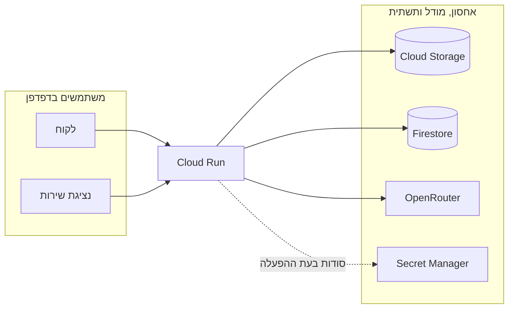

# customer_support_chatbot

צ׳אט שירות לקוחות ב-Cloud Run, פתוח לציבור ועם נתונים מדומים. מזינים מפתח OpenRouter, נכנסים לחשבון, מעלים מסמכים ושואלים על הזמנות ועל מדיניות החנות. ליד כל תשובה מופיע המקור שלה.

## מה מיוחד כאן

- **מצב ההזמנה מגיע ממערכת החנות:** כששואלים אם אפשר להגיע לאסוף, הצ׳אט קורא את הרשומה ב-Firestore. אישור שהועלה משמש לפרטים כמו מחיר או צבע.
- **החזרה לפי סוג המוצר:** הצ׳אט מזהה את קטגוריית המוצר באישור הפרטי, מתאים לה את הכלל מהמדריך המשותף ומציג את שני המקורות.
- **החשבון קובע מה מותר לקרוא:** השרת מחפש במסמכים של החשבון המחובר ובמסמכים המשותפים של נציגת השירות. לקוחות נכנסים בלי סיסמה, ולכן זו הפרדה בין חשבונות ולא הגנה על מידע. אל תעלו מידע אמיתי.
- **כל מבקר משתמש במפתח שלו:** מפתח OpenRouter נשמר בלשונית של הדפדפן ונשלח עם כל שאלה. השרת לא שומר אותו.
- **המודל בוחר מתוך מקורות מוגדרים:** OpenRouter מחזיר מזהים של קטעים. השרת מציג רק קטעים שהיו ברשימה שאושרה.
- **ה-Bucket פרטי:** Cloud Run שומר את הקובץ המקורי בזהות Service Account. הטקסט שחולץ נשמר ב-Firestore לצורך החיפוש.

## איך זה עובד



[תרשים הארכיטקטורה](artifacts/architecture.html) נפתח כקובץ מקומי. פירוט החיבורים וההרשאות נמצא ב-[docs/architecture.md](docs/architecture.md).

## הרצה

**צריך:** Python 3.12 ומעלה ו-`pdftotext` מתוך Poppler. לפריסה צריך גם פרויקט Google Cloud עם חיוב פעיל ו-`gcloud` מחובר.

**1. התקינו והריצו בדיקות:**
```bash
git clone https://github.com/almaya-ai/customer_support_chatbot.git
cd customer_support_chatbot
python3 -m venv .venv
.venv/bin/pip install -r requirements.txt
.venv/bin/python -m unittest discover -s tests -v
```

**2. פתחו את השירות מקומית:**
```bash
.venv/bin/flask --app main:create_app run
```

ב-`http://localhost:5000` נכנסים כנועה או כדן בלי סיסמה, וכנציגת שירות עם `service-local`. ההרצה המקומית משתמשת ב-SQLite ומציגה את קטעי המקור בלי מודל כברירת מחדל.

**3. שאלו על ההזמנה והעלו קבצים.** את [מדריך השירות](fixtures/service-guide.txt) מעלים מחשבון הנציגה. נועה מעלה את [אישור המנורה](fixtures/order-noa.txt) ודן את [אישור הכוננית](fixtures/order-dan.pdf). שניהם שואלים ״איך מחזירים את מה שקניתי בהזמנה שבקובץ?״. נועה מקבלת הנחיה להחזיר בסניף ודן מקבל הנחיה לתאם איסוף מהבית. כששואלים על מספר ההזמנה של הלקוח האחר, הצ׳אט מציין שהמידע לא זמין.

**4. פרסו ל-Cloud Run.** העתיקו את קובץ ההגדרות, מלאו `PROJECT` והכינו את הסוד לפי [מדריך התפעול](docs/runbook.md).
```bash
cp .env.example .env
gcloud auth login
./deploy.sh
```

**אם משהו לא עובד:** [טבלת התקלות](docs/runbook.md#פתרון-תקלות).

## מבנה

| נתיב | תפקיד |
|---|---|
| `main.py` | Flask, התחברות, העלאה ותשובות |
| `answers.py` | חילוץ טקסט, חיפוש ושליחת קטעים ל-OpenRouter |
| `store.py` | שמירת הזמנות ומסמכים ב-Firestore, ב-GCS או ב-SQLite |
| `templates/page.html`, `static/` | ממשק השיחה |
| `fixtures/`, `tests/` | קובצי דוגמה ובדיקות |
| `deploy.sh`, `Dockerfile`, `.env.example` | פריסה ותצורה |
| [`docs/`](docs/README.md), [`artifacts/`](artifacts/) | תפעול, החלטות ותרשים הארכיטקטורה |
| [`CLAUDE.md`](CLAUDE.md), [`.claude/`](.claude/README.md) | הגדרות הפרויקט, כללים וזיכרון |
